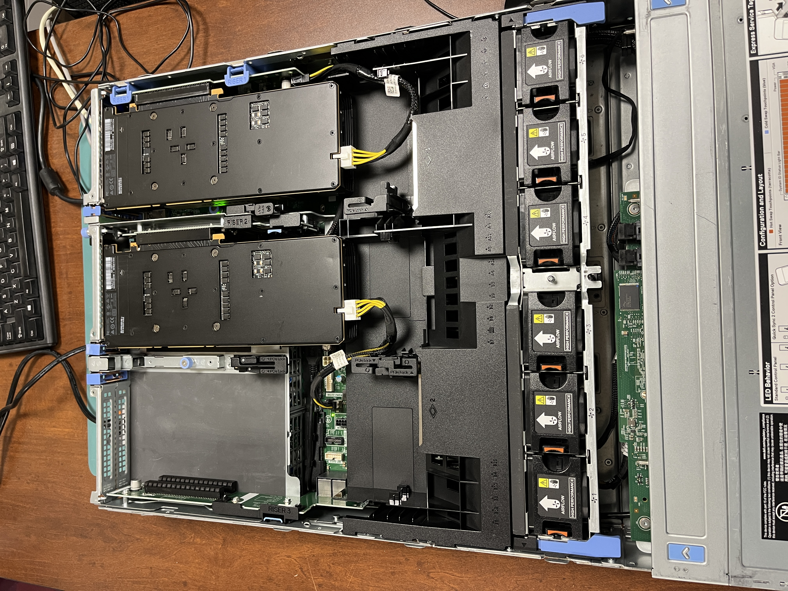
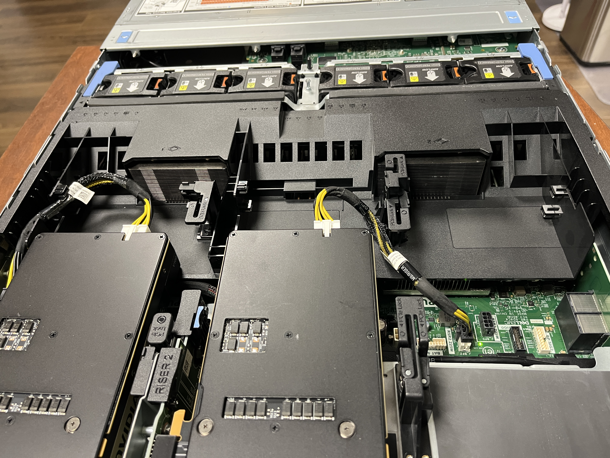
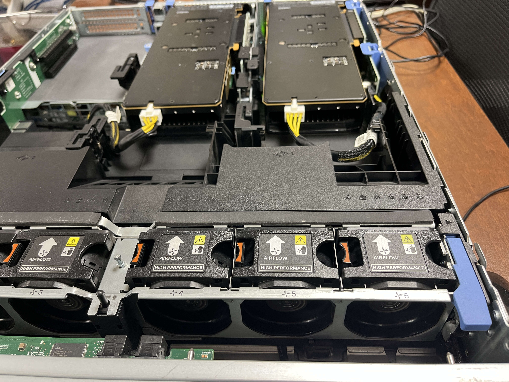
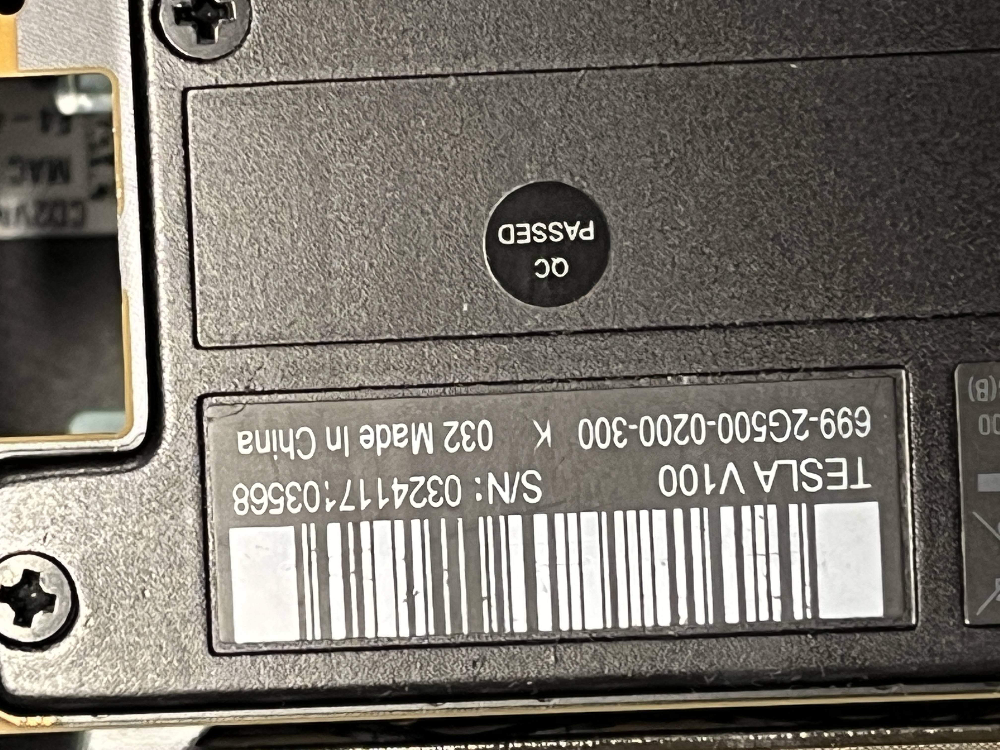
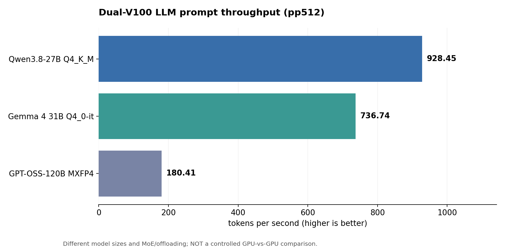
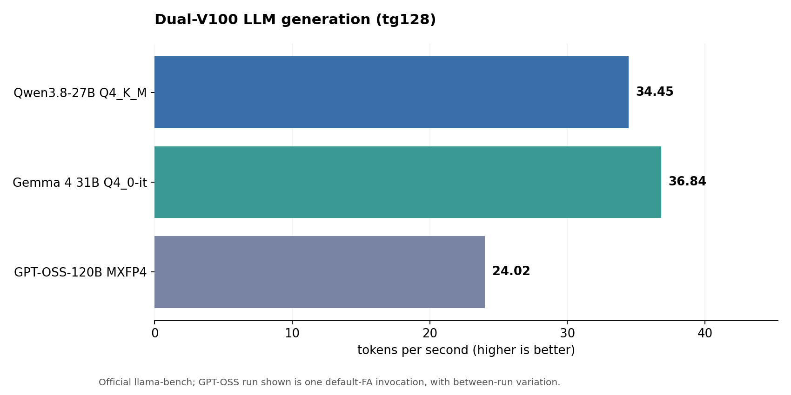
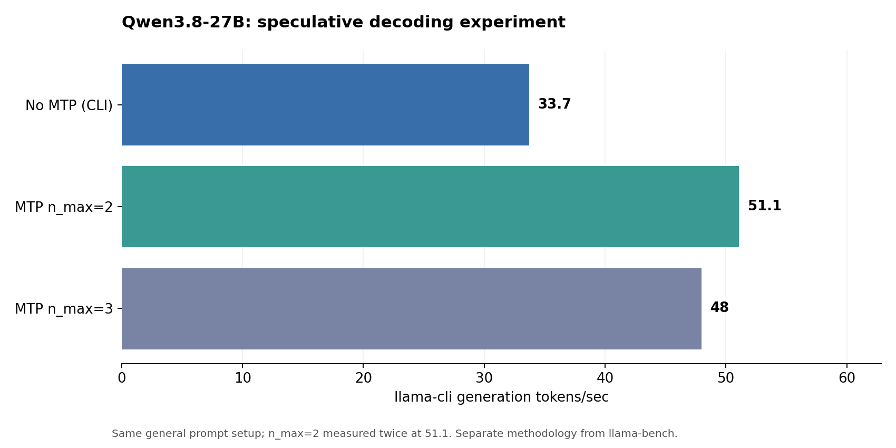
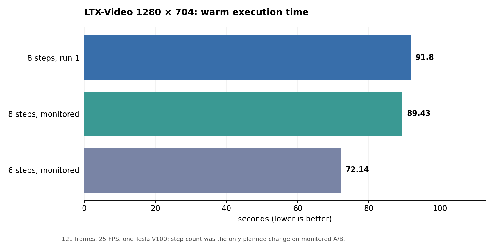

# Dell PowerEdge R740 — Dual Tesla V100 AI Benchmarks

**Local inference, speculative decoding, image generation and video generation on refurbished enterprise hardware**  
**Observed test period:** 30 October – 10 November 2026 (America/Edmonton)  
**Report status:** Community case study, initial publication draft; data transcribed from recorded session outputs.  
**Hardware:** Dell PowerEdge R740 · 2 × Tesla V100 PCIe 16 GB · 2 × Xeon Gold 6252 · 384 GB RAM

> **Main finding:** A dual-V100 R740 can run multi-model `llama.cpp` inference, including CPU/GPU hybrid GPT-OSS-120B and speculative decoding on Qwen/Gemma. Independently, **one** V100 successfully generated a ~4.84-second, 1280 × 704 LTX video in **72.14 seconds** at six sampling steps.
>
> **Important distinction:** The LLM results below use **both V100 GPUs** (unless explicitly marked single-GPU). The ComfyUI / LTX video results use **GPU 0 only**. Do not describe video results as dual-GPU acceleration.

*Sample frame from the user's generated 1280 × 704 sailboat video, shown for qualitative illustration; it is not an objective image-quality metric.*

https://github.com/user-attachments/assets/3e1efa71-0567-46b2-a288-f7ec16a9a609

## At a glance

| Workload / method | Observed result | Interpretation |
|---|---:|---|
| GPT-OSS-120B MXFP4 (`llama-bench`, pp512) | **~180 tokens/s** | CPU/GPU MoE; six controlled invocations, prompt rate consistent |
| GPT-OSS-120B MXFP4 (`llama-bench`, tg128) | **22.07–26.91 tokens/s** | Variation **between launches**; do **not** treat 26.91 as repeatable baseline |
| Qwen3.8-27B Q4_K_M (`llama-bench`) | **928.45 pp512 / 34.45 tg128 tokens/s** | Five repeats within invocation |
| Qwen3.8-27B, MTP speculative decoding | **51.1 generation tokens/s** | Same prompt reproduced twice; `n_max=2` |
| Gemma 4 31B Q4_0-it (`llama-bench`) | **736.74 pp512 / 36.84 tg128 tokens/s** | Five repeats within invocation |
| Gemma 4 31B MTP (`llama-cli`) | **77.0 generation tokens/s** | Exact successful CLI command; 84.2 observed on *different* prompt only |
| LTX-Video 0.9.6 Distilled 2B | **72.14 s end-to-end** | 1280 × 704, 121 frames, 25 FPS, six steps, **single V100** |

These are **not** identical workloads or an apples-to-apples model contest. `pp` means prompt processing; `tg` means token generation. `llama-bench`, `llama-cli` and ComfyUI measure different things. See [Methods and limitations](#methods-and-limitations).

## System configuration

| Component | Observed hardware / software |
|---|---|
| Server | Dell PowerEdge R740, 2U |
| CPU | **2 × Intel Xeon Gold 6252**, 24 cores/socket, 48 physical cores / 96 threads total |
| RAM | **384 GB** ECC DDR4, configured at **2400 MT/s** |
| GPU 0 | NVIDIA Tesla V100 PCIe 16 GB, Volta `sm_70`, PCI `0000:3B:00.0`, NUMA 0 |
| GPU 1 | NVIDIA Tesla V100 PCIe 16 GB, Volta `sm_70`, PCI `0000:AF:00.0`, NUMA 1 |
| OS | Debian 13 (trixie), headless, ZFS root and application datasets |
| NVIDIA driver | **580.196.07** |
| CUDA toolkit | **12.9.2**, `nvcc` **12.9.86** (driver advertises CUDA API compatibility 13.0) |
| LLM runtime | `llama.cpp` build **11998**, commit `78feec062d50ec9e8940244cac918ac4480b60cb` |
| Video runtime | ComfyUI **0.44.0**, PyTorch **2.14.1+cu126**, Docker, GPU 0 selected |
| Model management | Large model files on a separate ZFS AI-DATA pool; Docker ZFS backend |

The hardware uses passive server GPUs cooled by R740 chassis airflow. GPU temperatures below are *observations under the stated video workload*, not a universal cooling validation. This R740 does not have a full GPU Enablement kit, since the configuration does not have the low profile heat sinks, or low profile air flow shroud.  We found the cooling has been working very well, and therefore have not installed those parts.

## 1. Dual-V100 LLM results

### Standard `llama-bench` (five repetitions per invocation)

| Model | Quantization | pp512 (tokens/s) | tg128 (tokens/s) | Details |
|---|---|---:|---:|---|
| Qwen3.8-27B | Q4_K_M | **928.45 ± 5.11** | **34.45 ± 0.01** | 8 threads; `-ngl 99 -sm layer -ts 1/1`; `-r 5` |
| Gemma 4 31B | Q4_0-it | **736.74 ± 2.03** | **36.84 ± 0.01** | 8 threads; `-ngl 99 -sm layer -ts 1/1`; `-r 5` |
| GPT-OSS-120B | MXFP4 | **180.41 ± 1.85** | **24.02 ± 0.11** | One representative default-FA invocation; 16 threads, CPU+GPU MoE |

**Larger prompt for Gemma:** pp2048 **1085.15 ± 0.79** and tg256 **36.86 ± 0.01** t/s (different workload from the pp512/tg128 table).

**GPT-OSS-120B variability matters.** Across six separate five-repeat invocations, generation throughput was **22.07–26.91 t/s**, even when default/unspecified Flash Attention was repeatedly used. Prompt throughput remained near 180 t/s. The fastest number is a best *observation*, not a stabilized typical result. `-fa on` and `-fa off` tests did **not** establish a consistent Flash Attention advantage. The model is ~59.02 GiB, requiring CPU memory plus GPU offload on this hardware.

### Qwen speculative decoding

- Standard ordinary CLI generation: approximately **33.7 t/s** on an earlier no-MTP prompt run.
- **MTP (`draft-mtp`, `n_max=2`) produced 51.1 t/s twice** with the same deterministic NUMA explanation prompt. This is about **52% faster** than the 33.7 t/s reference, but the exact prompt/run records were not preserved identically for every baseline and variant; treat it as a practical observed uplift, not a strict controlled microbenchmark.
- `n_max=3`: **47.9** and **48.1 t/s**, both below `n_max=2`.
- DFlash variant: up to **39.2 t/s observed** in a reported later run, but the precise final flags were not retained. It did not beat the confirmed MTP `n_max=2` result.

### Gemma MTP

- Gemma 4 31B MTP with the draft model on `CUDA1`: **77.0 t/s** on the recorded NUMA explanation CLI prompt.
- An alternate tic-tac-toe reasoning prompt produced **84.2 t/s**, but this was **a different prompt**, not a comparable repeated benchmark.
- Attempting draft placement on `CUDA0` failed with a CUDA graph/tensor placement error in this setup; changing draft placement alone to `CUDA1` produced a successful run. See the exact command in `notes/reproduction.md`.

### Two independent single-V100 sanity checks

Using a Llama 3.1 8B Q4_K_M model (pp128 / tg32; `-r 1`):

| GPU individually selected | pp128 | tg32 |
|---|---:|---:|
| GPU 0 | 1139.90 | 122.11 |
| GPU 1 | 1138.89 | 121.58 |

These confirm both physical cards could execute inference independently; they are **not** dual-GPU measurements and use a different test size.

## 2. ComfyUI: image and video generation

**SDXL:** A separate working ComfyUI workflow successfully generated local still images. No comparable wall-clock SDXL benchmark series has been recorded for this report, so no invented SDXL speed claims appear here.

**Video:** ComfyUI 0.44.0 ran **LTX-Video 0.9.6 Distilled 2B** on **one V100 only**. Video at 25 FPS and 121 frames is **~4.84 seconds**, not exactly five seconds. The smaller LTX model is **not** Alex Ziskind's larger LTX-2.3 workload and must not be presented as a head-to-head comparison.

| Resolution | Frames | Sampling steps | Run type | End-to-end time |
|---|---:|---:|---|---:|
| 512 × 320 | 25 | 8 | Cold (initial load) | **24.56 s** |
| 512 × 320 | 25 | 8 | Warm | **2.30 s** |
| 512 × 320 | 121 | 8 | Warm | **12.44 s** |
| 1280 × 704 | 121 | 8 | Warm A | **91.80 s** |
| 1280 × 704 | 121 | 8 | Warm B, monitored | **89.43 s** |
| 1280 × 704 | 121 | **6** | Warm, monitored | **72.14 s** |

Reducing steps from 8 to 6 (same prompt, seed, resolution, model and frame count in the monitored comparison) changed **89.43 → 72.14 s**, a **19.3% reduction**. The user judged the visual quality to remain good, with recognizable boat motion and rippling water. This is subjective visual feedback, **not** a blinded quality measurement. Earlier high-res run averaged **90.62 s** across the two eight-step launches.

### Video GPU telemetry — GPU 0 only

Sampling via `nvidia-smi --query-gpu=timestamp,index,utilization.gpu,memory.used,power.draw,temperature.gpu --format=csv -l 1`:

| Metric | 8 steps | 6 steps |
|---|---:|---:|
| GPU 0 monitoring samples | 116 | 76 |
| Average utilization over **entire capture window** | 62.9% | 85.9% |
| Maximum utilization | 100% | 100% |
| Peak memory allocation | **9,918 MiB** | **9,918 MiB** |
| Peak reported power | **261.39 W** | **256.88 W** |
| Peak temperature | **66°C** | **64°C** |

**Telemetry caveats:** Monitoring windows included different amounts of idle time; the 62.9% and 85.9% averages are **not directly comparable efficiency metrics**. The power sensor briefly reported above nominal 250 W, which deserves follow-up but is not, alone, evidence of sustained over-limit operation. `nvidia-smi` sampled once per second; it cannot prove every transient or identify the root cause of overhead. VRAM allocated does not include all potential CPU offload needs.

### What was confirmed to run

The high-resolution video completed with an explicit ComfyUI API history status of `success` and an output node; history timestamps confirmed **91.80, 89.43, 72.14 seconds**. The 8-step 1280 × 704 run took roughly **67 seconds in diffusion sampling alone**. At six steps, the exact sampling-phase duration was not separately preserved. Temperature remained under 67°C in the recorded single-GPU workloads.

## 3. Methods and limitations

1. **Source:** Values are transcribed from recorded command outputs and ComfyUI execution history in private technical notes and local test sessions, not re-measured by this repository creation process. CSVs under `data/` preserve the report's individual data points.
2. **LLM repeat methodology:** `llama-bench -r 5` repeats within a single invocation. Between-invocation variation can be much larger than within-run standard deviation, especially for GPT-OSS-120B. Each model has different quantization, architecture, and offload requirements.
3. **CLI versus benchmark:** Speculative-decoding runs use `llama-cli`, actual prompt/completion behavior and draft models; do not combine CLI tokens/sec with fixed-size official `llama-bench` as if identical.
4. **GPU attribution:** Dual V100s were present and enumerated during llama.cpp testing; most dual-GPU model runs used layer splitting. Video was scheduled on one physical V100, and the second V100 was essentially idle.
5. **Video timing:** ComfyUI cold vs warm caches differ. Log `Prompt executed in` is end-to-end workflow time; where missing, the authoritative history `execution_start`→`execution_success` timestamp difference was used. Timing includes load/offload, sampling, VAE decode and save as applicable.
6. **No LTX-2.3 benchmark:** The video here is **LTX-Video 0.9.6 Distilled 2B**, not LTX-2.3; equal pixels and clip length do not imply equal complexity or quality.
7. **No causal claims without A/B:** Observed speed differences across independent prompts/builds are descriptive only. No claim is made that a specific driver, Flash Attention flag or GPU topology caused them without controlled tests.
8. **Public privacy:** Raw host logs, NAS locations, private network identifiers, service tokens, personal photographs, and large model weights are **not included**. The example still shows synthetic scenery only.

See [`notes/reproduction.md`](notes/reproduction.md) for commands and version details, and [`data/`](data/) for the compact tables used to build the charts.

## 4. Related study

**Previous GPU configuration (separate study):** [R740 with an RTX 2080 SUPER — GPT-OSS 120B tuning](https://github.com/medtech1/Local-LLM-Performance-Comparison---Dell-R740). That earlier repo documents an **8 GB RTX 2080 SUPER** and an older software environment; results should **not** be interpreted as a controlled same-day RTX-versus-V100 speedup.

**Other related work:** [Dell R640 Local LLM Performance Comparison](https://github.com/medtech1/Local-LLM-Performance-Comparison---Dell-R640).

## Reproducibility and next work

- Preserve model SHA-256, launch flags, `llama.cpp` commit, OS/kernel/driver/toolkit, NUMA placement, run date and raw output for new tests.
- Capture three or more *separate* identical invocations where possible, not only `-r 5` within one process.
- For future ComfyUI video tests, record start/end history timestamps and synchronized GPU telemetry, with consistent warmup and prompt, before comparing execution times.
- Future research: higher-quality image-to-video, native/upscaled 1080p, monitoring power spikes, and controlled multi-GPU LLM performance.

This is a hardware hobbyist community benchmark. Corrections and independent reproductions are welcome.
